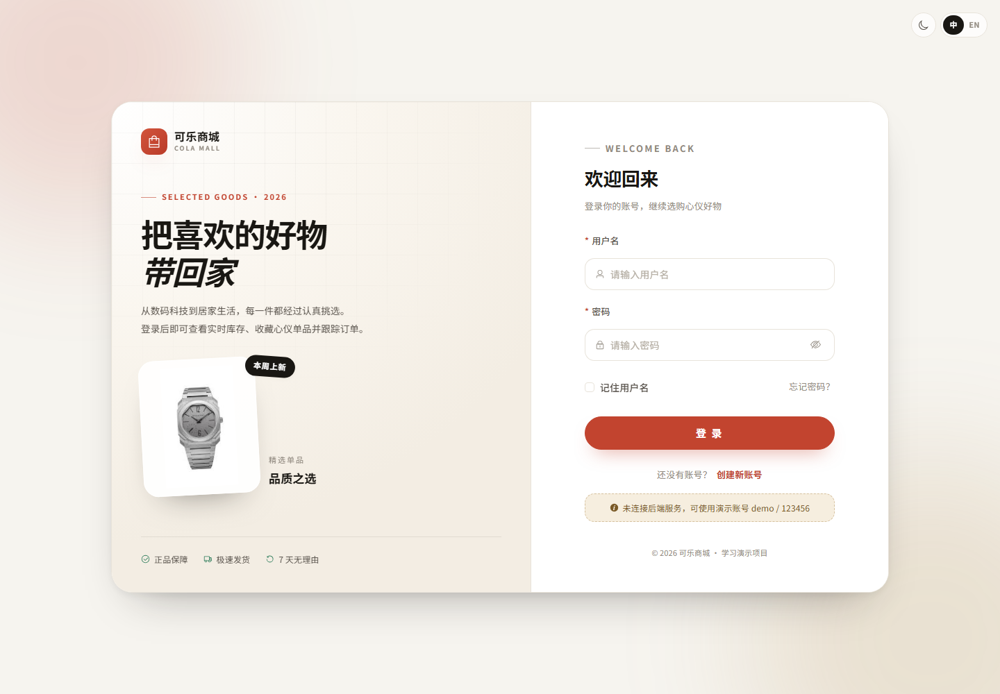
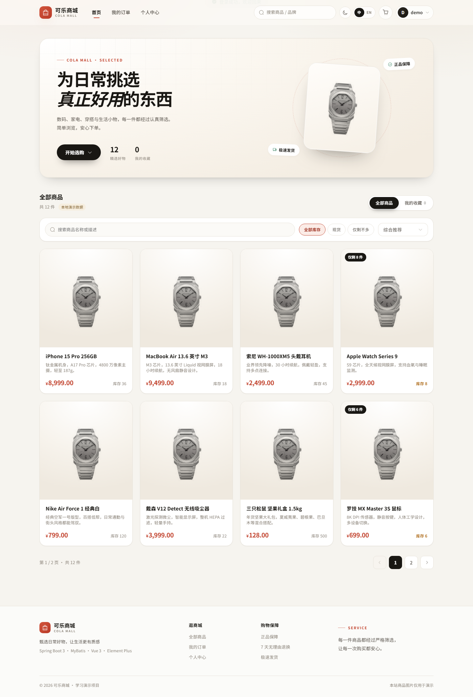
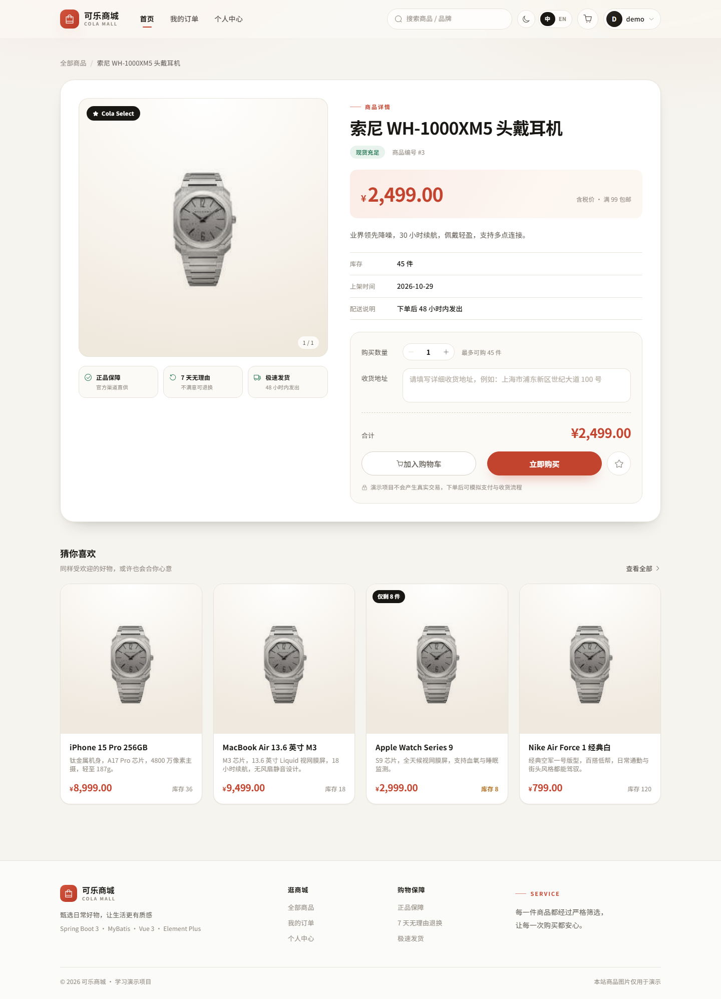
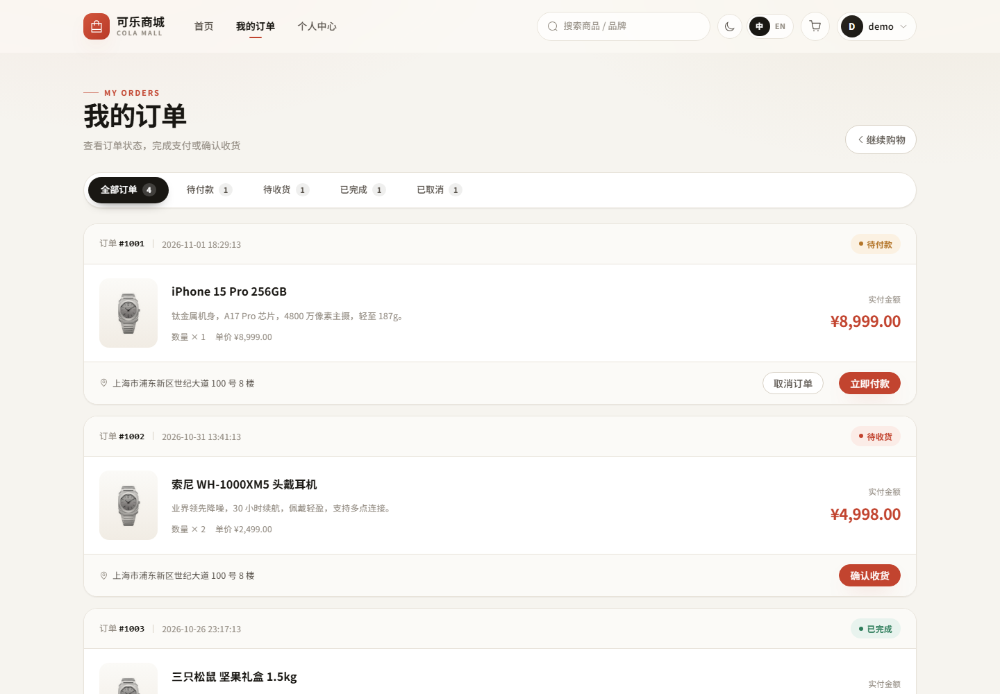
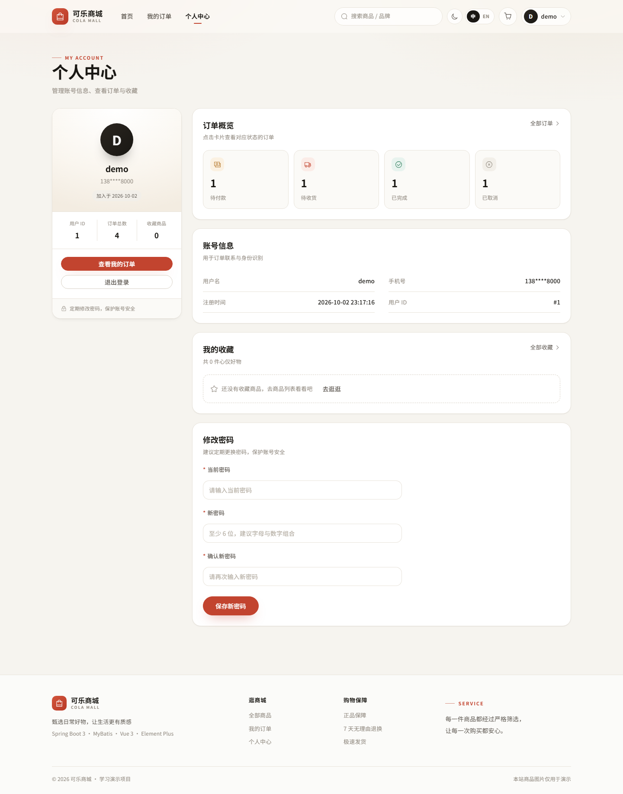
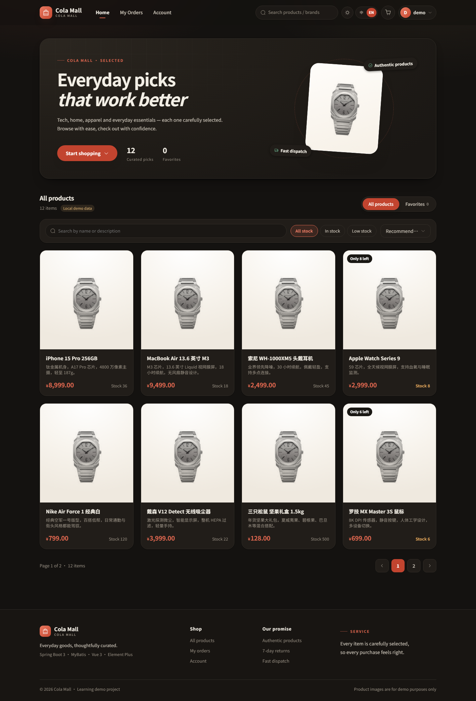

<div align="center">
  <h1>🥤 可乐商城 · 全栈电商系统</h1>
  <p>Spring Boot 3 + Vue 3 电商全栈项目｜登录注册 · 商品浏览 · 购物车 · 订单管理</p>
  <p>
    
    
    
    
  </p>
</div>

---

## 📋 项目介绍

一个完整的电商全栈示例：从数据库设计、JWT 鉴权后端，到经过视觉重构的 Vue 3 前端。
除了登录、浏览、下单、订单管理等基础流程，还补充了**购物车、商品收藏、修改密码、库存校验**等能力。

所有商品共用同一张展示图 `frontend/public/images.jpg`（见「商品图片」说明）。

### 功能一览

| 页面 | 功能 |
|------|------|
| 登录 / 注册 | 表单校验、JWT 登录态、记住用户名、显示 / 隐藏密码、演示账号提示 |
| 商品列表 | 首屏展示区、搜索、库存筛选、5 种排序、收藏视图、前端分页、骨架屏、空状态 |
| 商品详情 | 商品信息、库存状态、数量步进、收货地址、加入购物车、立即下单、猜你喜欢 |
| 购物车 | 侧边抽屉、数量增减、移除、金额合计、地址填写、一键结算 |
| 我的订单 | 状态筛选（含数量）、商品缩略图、付款 / 取消 / 确认收货、友好空状态 |
| 个人中心 | 账号信息、订单统计、我的收藏、修改密码、退出登录 |
| 语言 / 主题 | 中文 / English、浅色 / 深色一键切换，偏好自动记忆 |

---

## 📸 页面截图

| 登录页 | 商品列表 |
|:------:|:--------:|
|  |  |

| 商品详情 | 我的订单 |
|:--------:|:--------:|
|  |  |

| 个人中心 | 深色主题（English） |
|:--------:|:--------:|
|  |  |

---

## 🏗️ 项目结构

```
ecommerce/
├── backend/                          # Spring Boot 后端
│   ├── src/main/java/com/ecommerce/
│   │   ├── config/                   # JWT 拦截器、CORS/WebMVC、全局异常、BCrypt
│   │   ├── constant/                 # 订单状态常量
│   │   ├── controller/               # User / Product / Order 控制器
│   │   ├── dto/                      # 注册、修改密码请求体
│   │   ├── entity/                   # 实体类
│   │   ├── exception/                # 自定义异常
│   │   ├── mapper/                   # MyBatis 注解式数据访问
│   │   ├── service/                  # 业务逻辑（事务、库存、状态机）
│   │   ├── util/                     # JWT 工具
│   │   └── vo/                       # Result / OrderVO
│   └── src/main/resources/
│       ├── application.yml           # 数据源（环境变量注入）、MyBatis 配置
│       ├── application-local.yml     # 本机数据库账号（.gitignore 忽略）
│       └── application-local.yml.example
│
├── frontend/                         # Vue 3 前端
│   ├── public/images.jpg             # 全站统一商品图（运行时使用）
│   └── src/
│       ├── api/                      # Axios 封装 + 演示数据降级
│       ├── components/               # 导航栏、页脚、商品卡片、购物车抽屉、认证布局、设置
│       ├── composables/              # useAuth / useCart / useFavorites / useTheme
│       ├── i18n/                     # 中文 / English 文案字典
│       ├── router/                   # 路由 + 登录守卫
│       ├── styles/                   # reset / tokens / element 覆盖 / 深色主题
│       ├── utils/                    # 金额、日期、订单状态、存储工具
│       └── views/                    # 6 个页面
│
├── images.jpg                        # 商品图原始素材（与 public 副本内容一致）
├── api-docs.json                     # 旧版 OpenAPI 静态快照
└── init-data.sql                     # 建库建表 + 演示账号 + 12 件商品 + 4 条订单
```

---

## 🌐 多语言与主题

页面右上角（登录 / 注册页在页面右上角）提供两个控制：

- **中 / EN**：切换界面语言，覆盖导航、表单、提示、空状态、订单状态、Element Plus 分页等文案
- **月亮 / 太阳**：切换浅色 / 深色主题，商品图仍保留浅色“相纸”背景，避免白底图片在深色下发灰

偏好保存在 localStorage（`cola_locale`、`cola_theme`），刷新后保持不变；
首次访问没有偏好时，主题会跟随系统 `prefers-color-scheme`。

实现方式：

- `frontend/src/i18n/`：轻量字典 + `t(key, params)`，无额外依赖，语言切换实时生效
- `frontend/src/composables/useTheme.js`：切换 `html[data-theme]` 与 `.dark`，同时更新浏览器主题色
- `frontend/src/styles/dark.css`：深色主题下组件渐变、玻璃层、骨架屏和 Element Plus 变量的补充

---

## 🚀 技术栈

| 层 | 技术 |
|----|------|
| 后端 | Spring Boot 3.5 · MyBatis 3 · MySQL 8 · JWT (jjwt) · BCrypt · Maven |
| 前端 | Vue 3 (Composition API) · Vue Router · Element Plus · Axios · Vite |
| 体验 | 自研轻量 i18n · CSS 变量主题 · 响应式布局 · 设计变量（Design Tokens） |

---

## ⚡ 快速启动

### 前置条件

- JDK 17+
- Node.js ≥ 22
- MySQL 8
- Maven

### 1. 初始化数据库（仅限全新空库）

脚本会创建 `business` 数据库、建表，并写入演示账号、商品与订单。

> 如果本地 `business` 库已经有 `user` / `product` / `order` 数据，**请跳过这一步**。
> 脚本已做空表检测：商品和订单只在表为空时写入，仅补充缺失的 `demo` 账号，不会覆盖已有数据。

```bash
mysql -u root -p < init-data.sql
```

### 2. 启动后端

数据库账号有两种配置方式，任选其一：

**方式 A（推荐）：本地配置文件**

复制 `backend/src/main/resources/application-local.yml.example` 为
`backend/src/main/resources/application-local.yml`，填写本机数据库账号：

```yaml
spring:
  datasource:
    username: root
    password: 你的数据库密码
```

该文件已加入 `.gitignore`，不会被提交。项目默认激活 `local` profile，启动时自动读取。

**方式 B：环境变量**

```powershell
# Windows PowerShell
$env:DB_USERNAME="root"
$env:DB_PASSWORD="你的数据库密码"
# 可选：$env:JWT_SECRET="至少32位自定义密钥"
```

然后启动：

```bash
cd backend
mvn spring-boot:run
```

后端运行在 `http://localhost:8080`。

### 3. 启动前端

```bash
cd frontend
npm install
npm run dev
```

前端运行在 `http://localhost:5173`，`/api` 请求由 Vite 代理到 8080。

> 只需要预览页面时，可以只启动前端：检测不到后端会自动切换到本地演示数据。

---

## 🧪 演示账号

| 用户名 | 密码 | 说明 |
|--------|------|------|
| `admin` | `123456` | 已有测试数据库中的管理员账号，含历史订单 |
| `demo` | `123456` | 全新数据库由 `init-data.sql` 创建；前端离线演示同样使用该账号 |

> 如果你使用的是自己已有的数据库，请使用库中已有的账号登录；也可以在注册页创建新账号。

### 没有后端也能预览

如果只启动前端，接口会因后端不可达而自动降级到**本地演示数据**（保存在 localStorage）：
使用 `demo / 123456` 登录，即可完整体验「浏览 → 加购 → 结算 → 支付 → 收货 → 修改密码」流程。
列表页会显示「本地演示数据」标识，方便区分真实接口数据。

---

## 📮 API 接口

> `api-docs.json` 里的 `servers` 指向 **后端 API 地址** `http://localhost:8080`；
> 前端的 `http://localhost:5173` 只是 Vite 开发服务器，通过 `/api` 代理访问 8080，
> 因此 OpenAPI 文档中的端口与前端端口不同是正常的。
>
> 另外，`api-docs.json` 是早期导出的静态快照，未包含后来新增的
> `/user/password`、`/product/{id}` 等接口；完整且最新的接口以本 README 为准。
> 如果需要在线文档，可在后端接入 springdoc 后重新生成。

统一响应结构：`{ code: 200, message: "成功", data: ... }`。
除注册、登录、商品查询外，其余接口需要请求头 `Authorization: Bearer <token>`。

### 用户

| 方法 | 路径 | 说明 |
|------|------|------|
| POST | `/user/register` | 注册，JSON body |
| POST | `/user/login?userName=&userPassword=` | 登录，返回 token / userId / userName |
| GET | `/user/info` | 当前用户资料（由 Token 解析） |
| PUT | `/user/password` | 修改密码，JSON body `{ oldPassword, newPassword }` |

### 商品

| 方法 | 路径 | 说明 |
|------|------|------|
| GET | `/product/list` | 商品列表 |
| GET | `/product/{id}` | 按 ID 查询详情 |
| GET | `/product/detail?productName=` | 按名称查询 |
| POST | `/product/add` | 新增商品（需登录） |

### 订单（需登录）

| 方法 | 路径 | 说明 |
|------|------|------|
| POST | `/order/create` | 下单，body `{ productId, orderQuantity, orderAddress }` |
| GET | `/order/list` | 当前用户订单（含商品信息） |
| PUT | `/order/pay?orderId=` | 付款（0 → 1） |
| PUT | `/order/confirm?orderId=` | 确认收货（1 → 3） |
| PUT | `/order/cancel?orderId=` | 取消订单（0 → 4，库存回滚） |

---

## 🧩 订单状态

| 状态值 | 含义 | 可执行操作 |
|--------|------|------------|
| 0 | 待付款 | 付款 / 取消 |
| 1 | 待收货（已付款） | 确认收货 |
| 3 | 已完成 | 再次购买 |
| 4 | 已取消 | — |

状态流转由后端校验，重复支付、越权操作都会被拒绝。

---

## 🎨 前端设计与实现要点

- **设计系统**：`styles/tokens.css` 统一颜色、字体、圆角、阴影、动效曲线，页面只引用变量，避免魔法数字。
- **浏览器重置**：`styles/reset.css` 清除默认边距、统一盒模型、媒体元素与表单字体，并处理键盘焦点与减弱动效偏好。
- **柔和过渡**：卡片悬停上浮 + 图片缓慢缩放 + 阴影加深，统一 0.28s 缓动；页面切换使用淡入上移过渡。
- **布局留白**：1200px 内容宽度、4/3/2/1 列响应式网格、统一间距节奏，移动端重新组织工具栏与卡片。
- **商品图统一**：所有商品使用 `frontend/public/images.jpg`，通过 `object-fit: contain` + `mix-blend-mode: multiply` 融入暖色背景，避免白底图突兀。项目根目录的 `images.jpg` 为同内容原始素材。
- **状态管理**：`useAuth` / `useCart` / `useFavorites` 单例组合式函数，配合 localStorage 持久化，登录状态变化实时反映到导航栏。
- **健壮性**：骨架屏、空状态、加载失败提示、401 自动跳转、请求超时与后端不可用降级。

---

## 🔐 安全与业务校验

- BCrypt 加密存储密码，登录失败统一提示，避免暴露用户名是否存在。
- JWT 使用固定密钥（可通过 `JWT_SECRET` 覆盖），重启服务后旧 Token 仍然有效。
- 订单查询 / 操作全部基于 Token 中的用户 ID，忽略前端传入的 userId，避免越权。
- 下单时服务端重新计算金额、校验库存并扣减；取消订单回滚库存；状态流转使用条件更新防止并发重复操作。

---

## 📌 说明

- 商品图片仅用于学习演示，`init-data.sql` 中的商品与价格均为示例数据。
- 生产环境请替换 `JWT_SECRET`、限制 `/product/add` 的权限，并为数据库账号授予最小权限。
